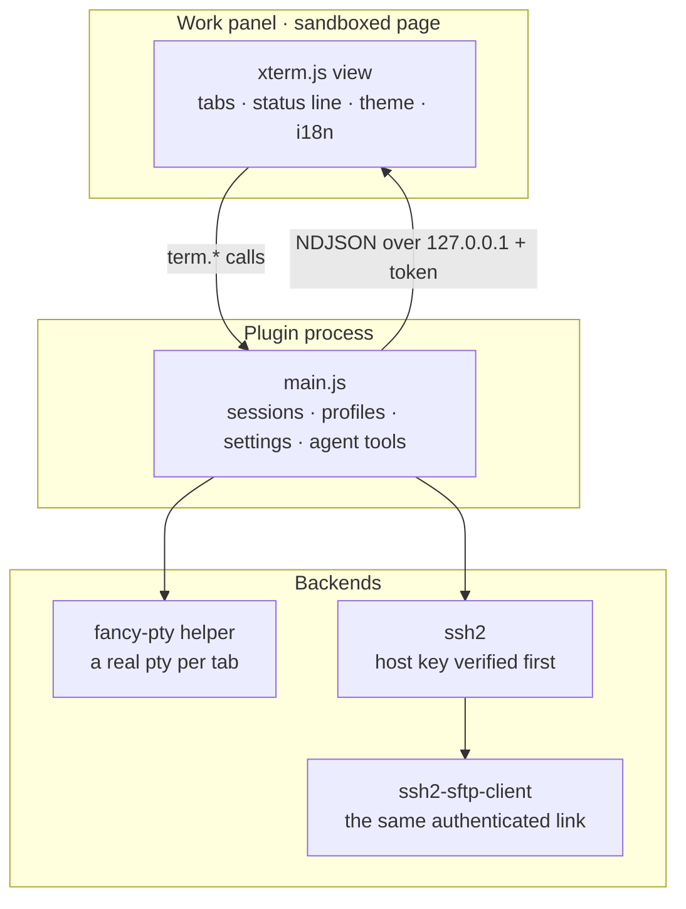
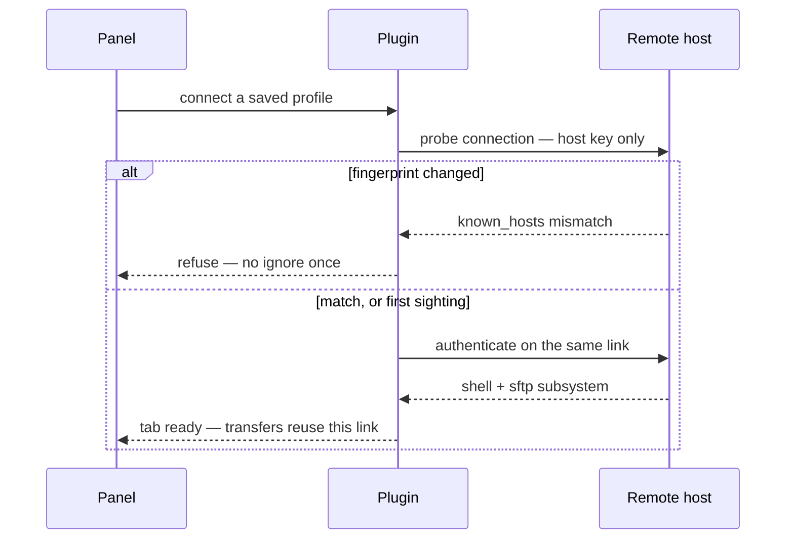

# PI-Terminal

**A terminal in PI-Desktop's work panel** — local shells and SSH sessions over a
real pty, with tabs, saved hosts, agent read/write access, and file transfers
over the same authenticated SSH connection.

[](LICENSE)


- **Plugin id** `cc.fee.pi-terminal`
- **Version** 1.0.0
- **Requires** PI-Desktop 0.20.0+
- **Author** Sunrise · **License** Apache-2.0

---

## Features

- **Local shells** — a real pty (not a pipe), so `vim`, `top`, `ssh`, `python`
  and anything else that needs a TTY behaves exactly as in a native terminal.
  Local terminals inherit the full system PATH, including entries added after
  PI-Desktop started.
- **SSH sessions** — key, ssh-agent or password auth, jump hosts (up to 4 hops),
  keepalive, and host-key verification in OpenSSH `known_hosts` format. A
  changed fingerprint always refuses the connection; there is no "ignore once".
- **Tabs and session management** — inline rename, right-click menu (copy
  session id / rename), per-session output ring buffer addressed by a monotonic
  `seq`, a live-session limit, and a status line that says whether output is
  streaming or falling back to polling.
- **Saved hosts** — grouped, collapsible, editable; the form shows only the
  fields the chosen authentication needs, and a saved secret is never echoed
  back.
- **File transfers** — upload and download files *and* folders over the same
  already-authenticated SSH connection (`ssh2-sftp-client`), with no second
  handshake and no second use of the credentials.
- **Agent access** — eight tools the model can call, split by risk. Reads are
  redacted; writes to a shell, file moves and credential-touching actions ask
  you first.
- **Follows PI-Desktop** — language (English / 简体中文) and light/dark theme
  come from the host, so the panel never looks like a foreign window.

---

## Install

### From a release

1. Download `pi-terminal-1.0.0.piplug` from
   [Releases](https://github.com/yanecc/PI-Terminal/releases).
2. In PI-Desktop: **Settings → Plugins → Install from file**.
3. Open the **Terminal** tab in the work panel.

Two permission warnings are expected and honest:
`Terminal reads and writes a real terminal on this machine` (for the loopback
output stream) and `high-risk permissions` (for the agent tools that write to a
shell).

### From source

```bash
git clone https://github.com/yanecc/PI-Terminal.git
cd PI-Terminal
npm install
npm run package        # builds, then → dist/pi-terminal-1.0.0.piplug (+ .sha256)
```

Then install `dist/pi-terminal-1.0.0.piplug` as above.

---

## Agent tools

All eight are registered under the plugin's prefix, so the full name is
`plugin_local_pi_terminal_<tool>`:

| Tool | Risk | What it does |
|---|---|---|
| `read` | low | read session output (secrets redacted) |
| `wait` | low | wait for the shell to go quiet |
| `session` | medium | `list` / `create` / `close` tabs (local shell or saved SSH profile) |
| `setting` | medium | `list` / `get` / `update` / `reset` plugin settings |
| `send` | high | type into a shell (one command per call) |
| `upload` | high | inline text, a local file, or a whole local folder → `remotePath` |
| `download` | high | a file (to `localPath`, or inline when small) or a folder |
| `profile` | high | `list` / `create` / `update` / `delete` / `test` saved SSH hosts |

Notes that matter in practice:

- **Omitting an id never means "all".** A bulk reset needs an explicit
  `key: "*"`, and a bulk close needs `sessionId: "*"`.
- **Passwords are never accepted through tools.** They are typed in the panel,
  because a password in a model conversation becomes part of the transcript.
- **`session action="list"` marks the tab you are looking at** with
  `active: true`, so the model can tell "the one on screen" from "the one it
  just created".
- Both transfer tools take **`stream`**: `false` (default) moves data in
  parallel chunks (`fastPut` / `fastGet`, and the fast folder variants); `true`
  uses a single stream (`put(readable)` / `get(remotePath, writable)`) for
  servers that do not support the extended requests. Every reply names the call
  that was actually used (`transport`), so an unexpected fallback is visible.

---

## Keyboard

| Shortcut | Action |
|---|---|
| `Ctrl+Shift+T` | new local terminal |
| `Ctrl+Shift+W` | close the current terminal |
| **right-click** | **paste** (no menu — matches terminal muscle memory) |
| `Ctrl+C` | copy **when text is selected**; otherwise sends `^C` to the shell |
| `Ctrl+V` / `Shift+Insert` | paste (asks first for multi-line) |

Command palette has exactly two cross-session entries:
`PI-Terminal: Close All Sessions` and `PI-Terminal: Reset All Settings`. New
sessions are created from the panel buttons, where the real panel size is known.

---

## How it works



The **control plane** is short request/response calls over the host's panel
bridge. Terminal output is continuous, and that bridge has a 30 s timeout and no
push channel, so output travels on a **loopback NDJSON stream** with
back-pressure (`xterm.write(..., cb)` decides when to read the next chunk). One
multiplexed connection serves the whole view — a browser caps connections per
host:port at 6, so one fetch per session would break from the 7th tab onward. If
the loopback port is unavailable, the view falls back to polling and says so in
the status line.

### SSH handshake



A connection test is a **probe, not a session**: it never occupies a live-session
slot, so testing a host cannot fail with a session-limit error.

---

## Security

- **Host keys are verified before any credential is sent.** The probe reads the
  key and refuses the handshake; credentials only follow a match or a first
  sighting you explicitly accepted.
- **Saved passwords are encrypted with the OS keystore** (DPAPI / Keychain /
  libsecret), with an explicit, visible fallback to a 0600 AES-256-GCM key file.
  A reveal is on demand and audited.
- **Agent reads are redacted** — `AWS_SECRET_ACCESS_KEY`, private keys, bearer
  tokens, vendor-prefixed tokens and long base64 blobs. You still see raw bytes.
- **`audit.jsonl` records who did what to which session** — never terminal
  content and never credentials.

See [`docs/SECURITY.md`](docs/SECURITY.md) for the full threat model and
[`docs/ARCHITECTURE.md`](docs/ARCHITECTURE.md) for the layering.

---

## Development

```bash
npm install
npm run build            # main.js, manifest.json, views/
npm run watch            # rebuild + reload on change
npm test                 # unit tests (ring buffer, redaction, known_hosts, framing, PATH, i18n)
npm run verify           # the full gate — everything below, in order
npm run package          # builds first, then dist/pi-terminal-<version>.piplug (+ .sha256)
```

`npm run verify` is the single source of truth for "is this good to ship". It
runs the type checker, the build, the unit tests, and then a chain of checks
that each drive **real** components rather than mocks:

| Check | What it actually starts |
|---|---|
| `build-env-test` / `path-check` | a pty with a crippled PATH, resolving a System32-only tool |
| `smoke` | a real pty + the loopback relay + the host bridge (commands, tools, ping) |
| `ssh-smoke` | a real ssh2 server, real OpenSSH keys generated with `ssh-keygen` |
| `jump-check` | a real two-hop jump chain, asserting the tunnel reaches the target |
| `sftp-check` | a real ssh2 server with an SFTP subsystem: every transfer call |
| `hostkey-confirm` | the prompt/accept/refuse flow against an unknown host |
| `hostkey-concurrent` | two simultaneous connections released by one confirmation |
| `secrets-remove-check` | keystore delete/retry/failure paths via an injected launcher |
| `profile-edit-check` | profile create/edit/group/clear semantics |
| `host-load-check` | the plugin loaded through **PI-Desktop's own sidecar** |
| `install-check` | the installed tree (not just the archive) has what it needs |
| `package-check` | archive structure, store-only, all six platform helpers + exec bits |
| `verify-store-zip` | the host's own unzipper constraints (CRC, UTF-8 names, headers) |
| `bundle-run-check` | the **extracted** tree, with `.git` and `node_modules` deleted |

`bundle-run-check` is worth explaining: PI-Desktop's installer refuses to copy
any directory named `node_modules`, so the archive ships none. That check
reproduces the installer (extract, then delete those directories) and asserts
the plugin still loads — otherwise "it works on my machine" is exactly the bug
that ships.

---

## Packaging

`.piplug` is a zip built **store-only** (no deflate) and **without a wrapper
directory**, using `node:zlib`'s `ZipEntry` + `createZipArchive`. Entry order,
`mode` and `modified` are set explicitly, so two builds from the same sources
produce byte-identical archives and the sha256 is worth comparing.

**The package contains no `node_modules`.** The installer skips that directory,
so every runtime dependency is bundled into `main.js` by esbuild; only Node
built-ins and ssh2's optional native accelerators (`cpu-features`, `nan`) stay
external, and ssh2 falls back to pure JS when they are absent. The two things
that genuinely need files on disk are published *outside* `node_modules`:
`bin/<platform>/` for the pty helpers and `vendor/font-list/` for font-list's
platform assets.

**Every build is cross-platform or it fails.** One `.piplug` carries the pty
helper for all six supported targets (`win32-x64`, `win32-arm64`, `darwin-x64`,
`darwin-arm64`, `linux-x64`, `linux-arm64`). If any is missing the packer exits
non-zero instead of shipping a bundle that only works on the build machine —
there is deliberately no "this platform only" mode.

---

## Project layout

```
src/
  host/            plugin main process (Node side)
    transport/     local pty and SSH transports
    ssh/           known_hosts, profiles, secrets, sftp
    relay/         loopback NDJSON server
    tools/         agent tool declarations and handlers
  view/            work-panel page (xterm.js)
  manifest.ts      single source of truth for manifest.json
scripts/           build, package and verification scripts
test/              unit tests and browser harness
docs/              architecture and security notes
```

---

## License

[Apache License 2.0](LICENSE). Third-party components and their licenses are
listed in [`THIRD_PARTY_NOTICES.md`](THIRD_PARTY_NOTICES.md).
